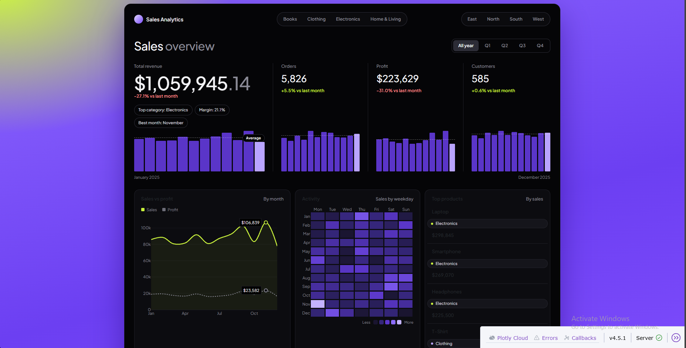

# Sales Analytics Dashboard

Interactive sales dashboard built with **Python, Dash, Plotly and Pandas**.

Uses a synthetic dataset for demonstration.



## Features
- Revenue headline with month-over-month change, plus Orders, Profit and Customers columns, each with a monthly bar sparkline and a dashed average line (hover a bar for its value)
- Auto-generated key insights (top category, margin, best month)
- Sales vs profit trend with the best month pinned
- Weekday-by-month activity heatmap
- Top 5 products with category tags
- Dark purple theme: pill filters for category and region, segmented control for quarter

## Performance choices
- Data loaded once with `functools.lru_cache`
- A single callback updates all components, so filters trigger one pass over the data
- Filtering and aggregation are done with vectorised Pandas operations

## Run locally
```bash
git clone https://github.com/<your-username>/sales-analytics-dashboard.git
cd sales-analytics-dashboard
python -m venv .venv && source .venv/bin/activate   # Windows: .venv\Scripts\activate
pip install -r requirements.txt
python generate_data.py      # creates data/sales_data.csv
python app.py                # open http://127.0.0.1:8050
```

## Project structure
```
app.py             # Dash app (layout + callback)
generate_data.py   # synthetic dataset generator
data/              # sales_data.csv
assets/            # style.css (theme) and screenshots
requirements.txt
```

## Roadmap
- [ ] Use a real dataset
- [ ] Customer segmentation view
- [ ] Deploy (Render / Hugging Face Spaces)

## Author
Louay - Business Analytics, Tunis Business School
